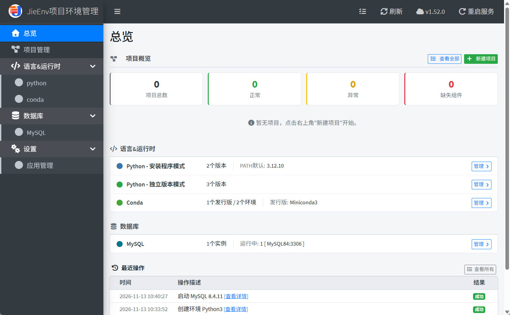
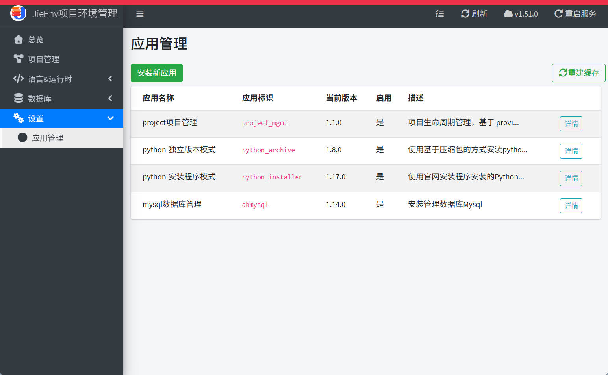

# JieEnv(win) — 本地开发环境一站式管理工具

> 面向 Windows 开发者的本地开发环境一站式管理工具，Provider 插件架构可自由扩展任意技术栈。


- Gitee: https://gitee.com/itjiedev/jieenv-win
- github: https://github.com/itjiedev/jieenv-win
- 哔哩哔哩：https://space.bilibili.com/379283376




---

## 当前实现功能

### 模块化按需安装
- 内置应用商店，需要什么装什么，无用功能可随时卸载



### 框架能力
- **Provider 架构**：插件式扩展，新语言/新数据库接入核心框架
- **统一终端**：所有应用共用终端启动逻辑，PATH 自动前置
- **任务指示器**：全局任务栏显示后台安装/下载进度
- **操作日志**：完整记录所有安装/卸载/配置变更

### 项目管理（可拆卸）
- **一键创建**：根据模板选择项目组合，自动完成运行时 + 数据库 + 配置生成
- **项目详情**：目录结构、依赖列表、环境绑定状态一目了然
- **健康检查**：Provider 驱动的生命周期校验，自动发现损坏环境
- **扩展融合**：支持自定义 Provider 插件，扩展项目管理能力（如支持新的语言、数据库等，需要按规范开发）

### 运行时管理（可拆卸）
- ** Pyhon 独立版本模式**：便捷管理完整版 Python zip运行时安装和环境管理
- ** Python Installer模式**：便捷管理 官方 python Installer 安装程序安装和环境管理
- ** Conda 环境管理**：便捷管理minconda或Miniforge 环境安装和管理

### MySQL 数据库管理（可拆卸）
- **多实例共存**：同一台机器同时跑多个 MySQL 版本
- **可视化操作**：建库、建表、用户授权、数据导入导出
- **服务生命周期**：启动 / 停止 / 配置文件编辑 / 端口冲突检测

---

## 下载文件说明

### 全量包（含所有内置应用）

| 文件名 | 说明 |
|---|---|
| `JieEnv-v1.50.1-full-setup.exe` | 全量安装包（安装程序，双击自动安装） |
| `JieEnv-v1.50.1-full-portable.zip` | 全量压缩包（解压后运行 `install.bat` 安装） |

### 平台包（仅含平台固定应用，不含扩展）

| 文件名 | 说明 |
|---|---|
| `JieEnv-platform-v1.50.1.zip` | 平台压缩包（解压后运行 `installplatform.bat`，不注册扩展应用） |
| `JieEnv-platform-v1.50.1-install.exe` | 平台安装包（安装程序自动安装） |

### 插件应用（独立打包，按需安装）

| 文件名 | 说明 |
|---|---|
| `project_mgmt-1.1.0.zip` | 项目开发环境管理 |
| `python_installer-1.17.0.zip` | Python Installer 环境管理（官方安装程序静默安装） |
| `python_archive-1.8.0.zip` | Python 独立版本环境管理（便携版，不写注册表） |
| `conda-1.2.7.zip` | Conda 环境安装和管理 |
| `dbmysql-1.14.0.zip` | MySQL 数据库多实例管理 |

直接下载插件应用进行安装或应用升级即可。

---

## 快速开始

### 方式一：安装程序（推荐）

下载 `JieEnv-win-Setup.exe`，双击运行即可完成安装。安装后可在开始菜单或桌面快捷方式启动。

安装程序会自动完成：
- Python 运行时部署
- 数据库初始化
- 应用注册
- 桌面快捷方式创建
- 注册到 Windows 卸载面板

### 方式二：便携包

便携包已自带 Python 运行时和全部依赖，解压即用，不写注册表：

```
1. 解压到任意目录（如 D:\JieEnv-win）
2. 双击 install.bat         # 首次初始化
3. 双击桌面快捷方式         # 启动桌面模式
```

---

## 系统要求

| 项目 | 要求 |
|---|---|
| 操作系统 | Windows 10 / 11（64 位） |
| 运行时 | Python 3.13.15（便携包自带） |
| 磁盘空间 |初始安装130 MB（含便携 Python）,后期根据项目需求动态扩展 |
| 网络 | 首次安装 Python/MySQL 镜像时需要 |

---

## License

详见 LICENSE 文件。