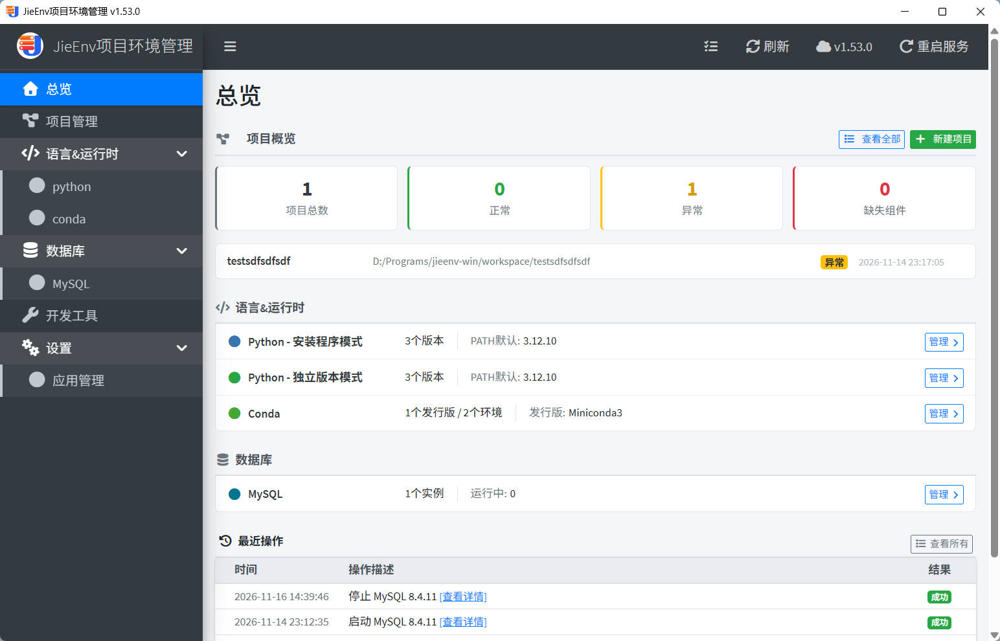
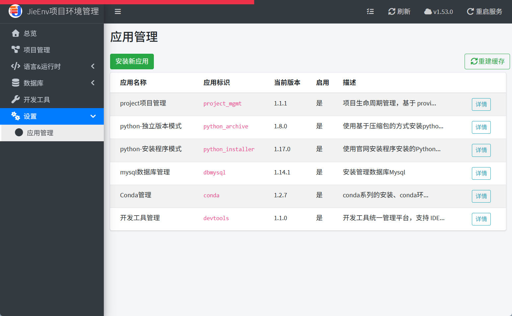

# JieEnv(win) — 本地开发环境一站式管理工具

> 面向 Windows 开发者的本地开发环境一站式管理工具，Provider 插件架构可自由扩展任意技术栈。

- Gitee: https://gitee.com/itjiedev/jieenv-win
- github: https://github.com/itjiedev/jieenv-win
- 哔哩哔哩：https://space.bilibili.com/379283376

---

## 当前实现功能

### 模块化按需安装
- 内置应用商店，需要什么装什么，无用功能可随时卸载

### 框架能力
- **Provider 架构**：插件式扩展，新语言/新数据库接入核心框架
- **统一终端**：所有应用共用终端启动逻辑，PATH 自动前置
- **任务指示器**：全局任务栏显示后台安装/下载进度
- **操作日志**：完整记录所有安装/卸载/配置变更

### 项目管理（可拆卸）
- **一键创建**：根据模板选择项目组合，自动完成运行时 + 数据库 + 配置生成
- **项目详情**：目录结构、依赖列表、环境绑定状态一目了然
- **健康检查**：Provider 驱动的生命周期校验，自动发现损坏环境
- **扩展融合**：支持自定义 Provider 插件，扩展项目管理能力（如支持新的语言、数据库等，需要按规范开发）

### 运行时管理（可拆卸）
- **Python 独立版本模式**：便捷管理完整版 Python zip 运行时安装和环境管理
- **Python Installer 模式**：便捷管理官方 Python Installer 安装程序安装和环境管理
- **Conda 环境管理**：便捷管理 miniconda 或 Miniforge 环境安装和管理

### 数据库管理（可拆卸）
- **MySQL 管理**：同一台机器同时安装运行多个 MySQL 版本，轻量级管理

### 开发工具（可拆卸）

- **IDE/编辑器**：支持多个 IDE/编辑器 安装卸载，如 VS Code、PyCharm 等
- **数据库客户端**：支持多个数据库客户端 安装卸载，如 DBeaver 等

## 下载文件说明

### 全量包（含所有内置应用）

| 文件名 | 说明 |
|---|---|
| `JieEnv-v1.54.0-full-setup.exe` | 全量安装包（安装程序，双击自动安装，可通过系统卸载） |

### 平台包（仅含平台固定应用，不含扩展）

| 文件名 | 说明 |
|---|---|
| `JieEnv-platform-v1.54.0-install.exe` | 平台安装包（安装程序自动安装，无扩展应用） |

### 升级包（已安装用户，推荐）

| 文件名 | 说明 |
|---|---|
| `JieEnv-upgrade-1.54.0.exe` | 全量守卫升级包，自动更新所有已安装的应用版本，未安装的跳过不硬塞（双击独立运行，不依赖 Django 进程） |
| `platform-1.54.0.zip` | 骨架升级包，**在软件内右上角升级功能中使用**，仅更新框架核心，省流量，不走 exe |
| `JieEnv-platform-v1.54.0-upgrade.exe` | 骨架升级包（exe 形式），关闭软件后使用，仅更新框架核心，省流量，双击独立运行 |

**使用场景说明：**

| 场景 | 选哪个 |
|------|--------|
| 软件能正常打开，想一键更新所有内容（框架 + 已安装的所有应用） | `JieEnv-upgrade-1.54.0.exe` |
| 软件打不开（白屏、启动报错等），升级程序独立运行不依赖 Django | `JieEnv-upgrade-1.54.0.exe` |
| 软件能正常打开，想在界面内点击更新平台，不想跑 exe | `platform-1.54.0.zip` |
| 只想更新框架核心，省流量，省心，用 exe 形式 | `JieEnv-platform-v1.54.0-upgrade.exe` |

### 插件应用（独立打包，按需安装）

| 文件名 | 说明 |
|---|---|
| `project_mgmt-1.1.1.zip` | 项目开发环境管理 |
| `python_installer-1.17.0.zip` | Python Installer 环境管理（官方安装程序静默安装） |
| `python_archive-1.8.0.zip` | Python 独立版本环境管理（便携版，不写注册表） |
| `conda-1.2.7.zip` | Conda 环境安装和管理 |
| `dbmysql-1.14.1.zip` | MySQL 数据库多实例管理 |
| `devtools-1.2.0.zip` | 开发工具管理 |

直接下载插件应用进行安装或应用升级即可。

---

## 快速开始

### 安装程序

下载 `JieEnv-v1.54.0-full-setup.exe`，双击运行即可完成安装。安装后可在开始菜单或桌面快捷方式启动。

安装程序会自动完成：
- Python 运行时部署
- 数据库初始化
- 应用注册
- 桌面快捷方式创建
- 注册到 Windows 卸载面板

---

## 系统要求

| 项目 | 要求 |
|---|---|
| 操作系统 | Windows 10 / 11（64 位） |
| 运行时 | Python 3.13.15（自带） |
| 磁盘空间 | 全量初始安装后基本程序约占 130 MB，后期根据项目需求动态扩展 |
| 网络 | 需要连接外网，用于下载应用资源（如 Python 镜像、数据库镜像等） |

---

## License

详见 LICENSE 文件。